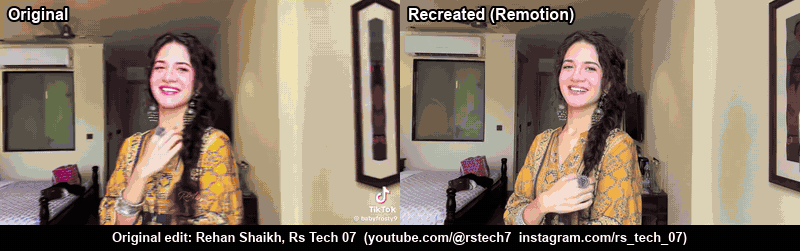

# edit-recreator

**Give Claude a reference edit and your own clips; get the same edit back, rebuilt frame by frame in code.**



*Left: the original edit. Right: our Remotion recreation of it from the same template footage.
Original edit by Rehan Shaikh, Rs Tech 07 ([YouTube @rstech7](https://youtube.com/@rstech7),
[Instagram @rs_tech_07](https://instagram.com/rs_tech_07)), shown with credit. The original project and its assets are not included in this repository.
Full 21.6 s side-by-side with sound: [docs/demo.mp4](docs/demo.mp4). The song belongs to its rights holders.*

`edit-recreator` is a [Claude Code](https://claude.com/claude-code) skill and plugin for recreating short-form
video edits (TikTok, Reels, Shorts, CapCut or After Effects templates) in [Remotion](https://www.remotion.dev),
with your own photos and videos swapped in. Instead of eyeballing, Claude **measures** the reference: every
cut, flash and transition, the speed ramps and slow motion, the camera moves, the text positions and colours.
Then it **checks its own render against the reference, side by side, frame by frame**, until they match.

**In short:** edit-recreator is a free, open-source (MIT) tool that lets an AI coding agent copy a video edit
you like, such as a TikTok trend, an Instagram Reel, a YouTube Short, a CapCut template or an After Effects template,
and rebuild it with your own photos and clips. It does this without After Effects or paid plugins, by rebuilding
the edit as a [Remotion](https://www.remotion.dev) (React) video. It works best with
[Claude Code](https://claude.com/claude-code); the method is plain Markdown plus Python scripts, so other agents can follow it too.

It was built while recreating a real birthday edit (a viral After Effects template that needed paid plugins
we didn't have), and it packages everything that made that work: the tools, the method and the mistakes.

## What it does

- **Analyses the reference**: every frame (no gaps), a per-frame motion profile that finds every transition
  window and draws its speed graph (like an After Effects graph editor), cuts and one-frame flashes,
  the subject's face track (for framing, zooms and pans), and the creator's retiming (slow motion, freezes,
  reverse, ramps) when the source clip is available.
- **Lets you choose your footage by pictures**: labelled pose sheets (pick "D12") and before/after plan sheets.
- **Prepares your media**: smooth slow motion with RIFE in-between frames; clean cut-outs with BiRefNet
  (hair, hands, white fabric on white walls) plus mask clean-up; optional upscaling with Real-ESRGAN; several
  enhancement **versions** side by side, so a face enhancer never silently changes a real person's face.
- **Builds in Remotion** with reusable blocks: face-true framing (`Framed`), slow-motion slot playback,
  eased keyframe curves from measurements, real 3D extruded text.
- **Proves it matches**: dense reference-vs-ours sheets, big ruled comparison frames, a cut-off-text audit,
  and a sync check that proves audio and cuts didn't move between rounds.

## Install

**As a plugin** (recommended):
```bash
claude plugin marketplace add Ahsuu27488/edit-recreator
```
```bash
claude plugin install edit-recreator@edit-recreator
```
Then ask Claude: *"Recreate this edit with my clips"* and point it at your reference video and footage.

**Examples of use**, from the full "same edit, my clips" job to single tasks like finding every transition,
checking sync or getting clean cut-outs: [EXAMPLES.md](plugins/edit-recreator/EXAMPLES.md).

**As a plain skill**: copy `plugins/edit-recreator/skills/recreate-edit/` to `~/.claude/skills/recreate-edit/`.

### Requirements
- ffmpeg, Node 18+, Python 3.10+ (a venv is recommended)
- `pip install -r plugins/edit-recreator/skills/recreate-edit/requirements.txt`
  (add `requirements-face.txt` for face tracking and the optional GFPGAN version)
- Open-source tools and weights, downloaded once from their official releases (nothing is bundled):
  `python plugins/edit-recreator/skills/recreate-edit/scripts/fetch_tools.py`
- A Vulkan-capable GPU helps RIFE and Real-ESRGAN (they also run on CPU, slowly).

## How it works

```
reference edit ──► extract every frame ──► motion profile (transition windows + speed graph)
                     │                      cuts / flashes · face track · retiming · colours · text
                     ▼
your footage ──► pose sheets ──► you pick ──► prep: RIFE slow-mo · BiRefNet cut-outs · versions
                     ▼
Remotion scenes on measured keyframes ──► render a range ──► side-by-side sheets vs reference
                     ▲                                              │
                     └──────────────── fix what differs ◄───────────┘
```

The full method is in [`SKILL.md`](plugins/edit-recreator/skills/recreate-edit/SKILL.md) and its
[reference docs](plugins/edit-recreator/skills/recreate-edit/reference/), including a
[lessons file](plugins/edit-recreator/skills/recreate-edit/reference/lessons.md) of every mistake that cost a round.

## Scripts

| Script | What it does |
|---|---|
| `extract_ref.py` | Every reference frame, named by your timeline's frame numbers |
| `motion_profile.py` | Per-frame motion; transition windows to study one frame at a time; speed graph |
| `find_cuts.py` | Hard cuts and one-frame flashes |
| `face_track.py` | Subject's face centre and size per frame (framing, zooms, pans) |
| `speed_match.py` | The creator's retiming against their source clip |
| `analyze_media.py` | Scores your photos and video frames (face size, sharpness, angle) |
| `pose_sheet.py` / `plan_sheet.py` | Labelled pose pickers and NOW-vs-NEW plan sheets to show the person |
| `external_enhance.py` | Join all clips into one video per orientation for an app enhancer, then split back |
| `prep_slots.py` | Footage → Remotion image sequences per version: RIFE, BiRefNet cut-outs, upscaling |
| `pair_sheet.py` / `pair_hi.py` | Reference-vs-ours sheets (every frame / big and ruled) |
| `sync_check.py` | Proves audio and cuts are identical between two renders |
| `aep_text.py` | Lists text layers and fonts in an After Effects `.aep` |
| `fetch_tools.py` | Downloads RIFE, Real-ESRGAN, BiRefNet, GFPGAN from official releases |

## FAQ

**How do I recreate a TikTok or Instagram Reels edit with my own photos and videos?**
Install the plugin (see [Install](#install)), give Claude Code the reference video and a folder of your clips, and ask
*"Recreate this edit with my clips."* It measures the reference, lets you pick your shots from pose sheets, builds
the edit in Remotion and compares it with the original frame by frame.

**Can I use an After Effects template without After Effects?**
Yes. That is why this tool exists. The reference was an After Effects project that needed paid plugins (Deep Glow,
Sapphire, BCC, Twitch, RSMB). edit-recreator rebuilds the look from the rendered video instead, so neither After
Effects nor the plugins are needed. `aep_text.py` can still read text layers and fonts out of an `.aep` file.

**Can it copy a CapCut template?**
It works from the finished video, so any edit you can download as a video can be the reference, whichever app made it.

**Is it free?**
The repository is MIT-licensed and every model it downloads is open source. Remotion is free for individuals and
companies of up to 3 people; larger companies need a Remotion licence (see [Licence](#licence)).

**Which AI models does it use?**
RIFE for smooth slow motion (frame interpolation), BiRefNet for background removal and cut-outs, Real-ESRGAN for
optional upscaling, and GFPGAN only as an opt-in comparison version. Everything runs locally; nothing is uploaded.

**Do I need a GPU?**
No. A Vulkan-capable GPU makes RIFE and Real-ESRGAN much faster, but everything also runs on CPU. It was built on a
laptop with a 2 GB GPU.

**How accurate is the recreation?**
See the demo above: the same footage, original left and recreation right. Accuracy comes from measuring every
frame and checking every frame, not from guessing. The skill will not call a scene done until the side-by-side
sheets match.

**Does it work with other AI agents besides Claude Code?**
It is packaged as a Claude Code plugin and skill. The method ([SKILL.md](plugins/edit-recreator/skills/recreate-edit/SKILL.md))
and scripts are plain Markdown and Python, so any agent that can run shell commands can follow them.

## Respect people and creators

- Use footage of people **with their consent**. Keep their media out of git and out of anything you publish.
- Recreating a style for a personal gift is one thing; re-publishing someone's template assets, music or fonts
  is another. Only ship assets you have the rights to (many "free" fonts are personal-use only).
- Face restoration can change a real face. Show side-by-sides and let the person decide.

## Licence

This repository is [MIT](LICENSE). It downloads and uses third-party software under their own licences; see
[NOTICE.md](NOTICE.md). **Remotion is not open source**: it is free for individuals and companies of up to
3 people, larger companies need a [Remotion company licence](https://www.remotion.dev/license).
